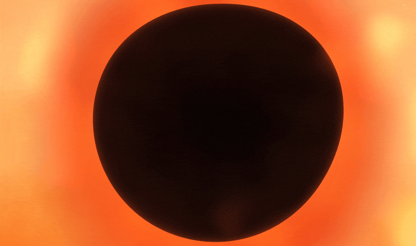
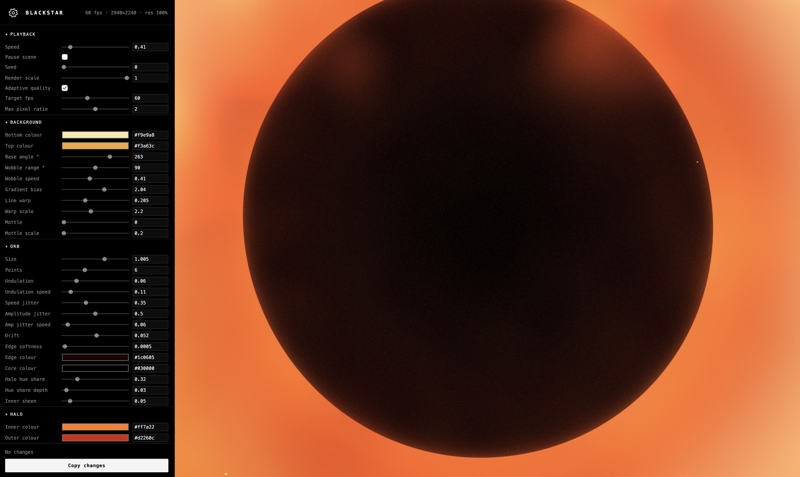

# Blackstar


## Run locally
There are no dependencies and no build step. Run:

```sh
python3 -m http.server 8000
```

Then open <http://localhost:8000>.

## Editing parameters

Press `d` to show the controls, then edit any parameter. Copy the changes as a block back into Claude for easy mass updates.


